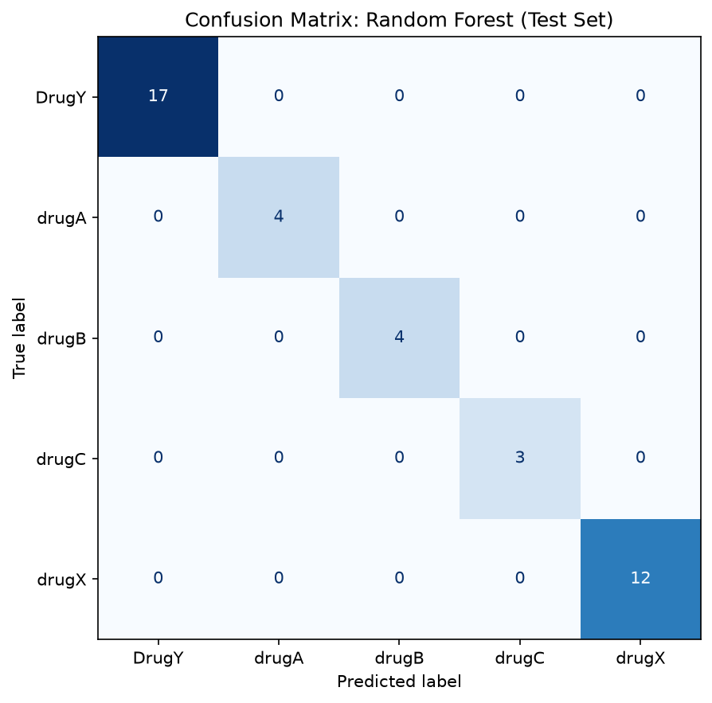
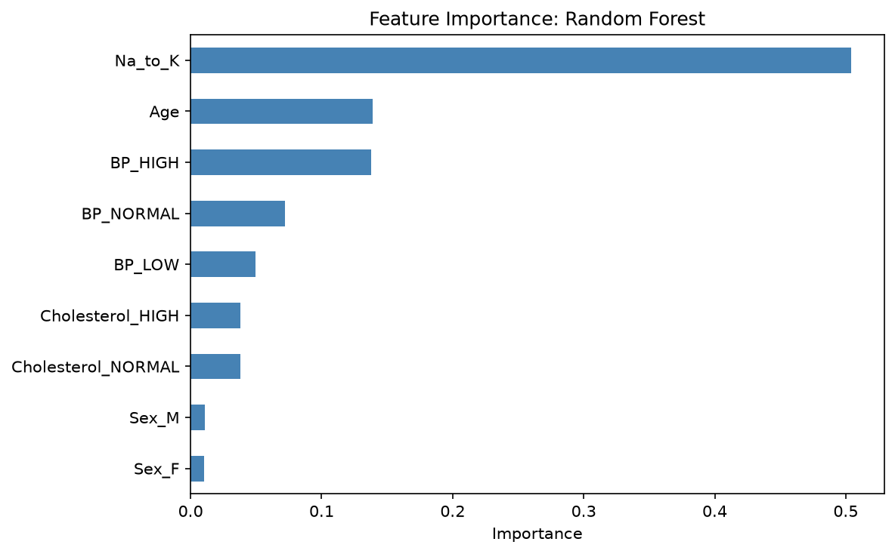

<h1 align="center">🤖 Pharmacy ML Model</h1>

<p align="center">
  <b>Predicting Drug Class from Patient Data in a Sample Dataset</b>
</p>

<p align="center">
  
  
  
  
  
</p>

> ⚠️ **Educational project.** This model is trained on a synthetic learning dataset. It is not a clinical tool and must not be used to make or support real prescribing decisions.

## 📑 Table of Contents

- [Overview](#-overview)
- [Learning Objectives](#-learning-objectives)
- [Dataset](#-dataset)
- [Project Structure](#-project-structure)
- [Approach](#-approach)
- [Results](#-results)
- [Why Accuracy Is High Here](#-why-accuracy-is-high-here)
- [Key Takeaways](#-key-takeaways)
- [Limitations](#-limitations)
- [How to Run](#-how-to-run)
- [Tools](#-tools)
- [Next Steps](#-next-steps)

## 📖 Overview

This project trains and evaluates a first machine learning classifier on the `drug200` dataset. It is **Week 2 of a four-week project** that combines PharmD training with data science, and it builds directly on the Week 1 exploratory analysis ([pharmacy-eda](https://github.com/emmydenco/pharmacy-eda)).

The focus is on fundamentals rather than a high score: preparing features, splitting data into training and test sets, measuring accuracy properly, and reading a confusion matrix instead of trusting a single number.

## 🎯 Learning Objectives

- Prepare categorical patient variables for a model using one-hot encoding.
- Split data correctly into training and test sets without leaking information.
- Train and compare more than one model type.
- Evaluate with accuracy, a confusion matrix, and per-class metrics.
- Understand which features the model relies on.
- Judge a result honestly, including why a high score can be misleading.

## 🗂️ Dataset

`drug200.csv` contains **200 patient records**. The file is **synthetic**: it was generated with fixed rules and a fixed random seed (42), so it does not represent real prescribing data.

| Column | Type | Description |
| --- | --- | --- |
| `Age` | Numeric | Patient age in years |
| `Sex` | Categorical | F or M |
| `BP` | Categorical | HIGH, NORMAL, or LOW |
| `Cholesterol` | Categorical | HIGH or NORMAL |
| `Na_to_K` | Numeric | Sodium-to-potassium ratio |
| `Drug` | Target | The drug assigned (`DrugY`, `drugA`, `drugB`, `drugC`, `drugX`) |

The classes are imbalanced: DrugY has 84 records, drugX 60, drugA 23, drugB 20, and drugC 13.

## 📁 Project Structure

```text
pharmacy-ml-model/
├── .gitignore
├── drug200.csv                 # synthetic dataset
├── notebook_ml.ipynb           # data prep, training, evaluation
├── images/                     # charts used in this README
│   ├── confusion_matrix.png
│   └── feature_importance.png
├── requirements.txt            # project dependencies
└── README.md
```

## 🔬 Approach

1. **Load and inspect** the data and confirm there are no missing values.
2. **Encode** the categorical columns (`Sex`, `BP`, `Cholesterol`) with one-hot encoding, giving 9 numeric features.
3. **Split** the data 80/20 into 160 training and 40 test records, stratified by drug, with `random_state=42`.
4. **Train** a Decision Tree and a Random Forest (100 trees) on the training set only.
5. **Evaluate** on the untouched test set with accuracy, a confusion matrix, and a classification report.
6. **Inspect** feature importance to see which inputs drive the predictions.
7. **Stress-test** the result with a tree-depth experiment and 5-fold cross-validation.

## 📊 Results

### Test Set Performance

| Model | Train Accuracy | Test Accuracy |
| --- | --- | --- |
| Decision Tree | 1.000 | 1.000 |
| Random Forest (100 trees) | 1.000 | 1.000 |

Both models tied, so the Random Forest was chosen for Week 4 because it is generally more robust on noisy data, not because it scored higher here.

### Confusion Matrix (Random Forest, Test Set)



All 40 test records fall on the diagonal, so the model made no misclassifications, and precision and recall are 1.00 for every drug. The test set contains only 4 drugA, 4 drugB, and 3 drugC records, so this evaluation says little about how the model would handle rare classes.

### Feature Importance



| Feature | Importance |
| --- | --- |
| `Na_to_K` | 0.504 |
| `Age` | 0.139 |
| `BP_HIGH` | 0.138 |
| `BP_NORMAL` | 0.072 |
| `BP_LOW` | 0.050 |
| `Cholesterol_HIGH` | 0.038 |
| `Cholesterol_NORMAL` | 0.038 |
| `Sex_M` | 0.011 |
| `Sex_F` | 0.010 |

`Na_to_K` is the most important feature, followed by `Age` and blood pressure, while `Sex` contributes almost nothing. This agrees with how the synthetic labels were generated. Importance describes what this model uses on this dataset and does not show a clinical or causal relationship.

### Tree Depth Experiment

| max_depth | Train Accuracy | Test Accuracy |
| --- | --- | --- |
| 1 | 0.719 | 0.725 |
| 2 | 0.838 | 0.825 |
| 3 | 0.938 | 0.925 |
| 4 | 1.000 | 1.000 |
| 5 | 1.000 | 1.000 |

Accuracy rises with depth until depth 4 and then stops improving. Training and test accuracy stay close at every depth, so the tree was not overfitting. The depth needed is consistent with the layered rules used to generate the labels.

### 5-Fold Cross-Validation

| Model | Fold Scores | Mean | Std |
| --- | --- | --- | --- |
| Decision Tree | 1.0, 1.0, 1.0, 1.0, 1.0 | 1.000 | 0.000 |
| Random Forest | 1.0, 1.0, 1.0, 1.0, 1.0 | 1.000 | 0.000 |

Perfect scores on every stratified fold show that the result was not caused by one favorable split of 40 patients.

## 🔎 Why Accuracy Is High Here

The `drug200` labels were generated from fixed rules based on the input columns. Tree-based models can recover rules like these very easily, so perfect scores are expected. A high score therefore says more about the dataset than about clinical usefulness.

On real prescribing data, results would be lower and would need far more careful validation, including external datasets, clinical review, and checks for bias and safety.

## 💡 Key Takeaways

- **A perfect score is not proof of a good model.** Here it reflects rule-based synthetic labels, which is why the evaluation was checked with a confusion matrix, a depth experiment, and cross-validation.
- **The confusion matrix and class counts matter more than one number.** With only 3 to 4 test records for the rarest drugs, even a perfect score gives little evidence about those classes.
- **Feature importance acted as a sanity check.** The model relied on `Na_to_K`, age, and blood pressure and ignored `Sex`, matching how the data was built.
- **Next time, with real data:** I would expect lower scores, test on an external dataset, and involve clinical review before drawing any conclusions.

## 🚧 Limitations

- Small, synthetic dataset, so the results do not transfer to real patients.
- Perfect scores on every measure mean this evaluation cannot show how the model handles noise or ambiguity.
- Very few test records for drugA, drugB, and drugC.
- **No external validation** and no clinical review.
- The model sees only five inputs and ignores allergies, comorbidities, drug interactions, and renal or hepatic function.
- **Not intended for any real prescribing decision.**

## 🚀 How to Run

```bash
git clone https://github.com/emmydenco/pharmacy-ml-model.git
cd pharmacy-ml-model
pip install -r requirements.txt
jupyter notebook
```

Open `notebook_ml.ipynb` and run the cells from top to bottom. If you use VS Code, install the **Python** and **Jupyter** extensions, open the notebook, and select your Python environment as the kernel.

## 🧰 Tools

Python · pandas · scikit-learn · seaborn · matplotlib · Jupyter Notebook · VS Code

## ➡️ Next Steps

- **Week 3:** study how AI is used in medicine and relate it to pharmacy practice.
- **Week 4:** add rule-based safety checks and deploy the model as a Streamlit app.

<p align="center">
  <sub>Part of a 4-week Pharmacy + AI learning project by Adebayo Denis Emmanuel, PharmD student, University of Ilorin. Built by Emmydenco™.</sub>
</p>
